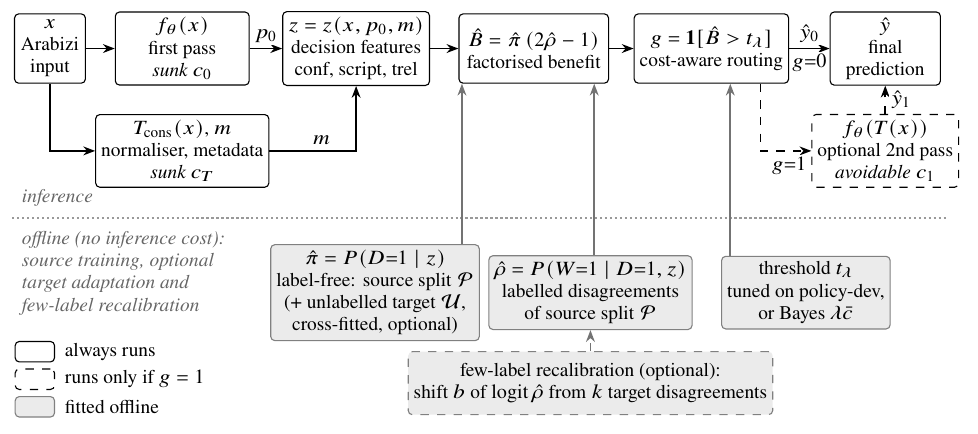

# SelectNorm

**SelectNorm: A Disagreement-Factorized Analysis of Per-Input Normalization for Arabizi with Frozen Encoders**

Research code, archived experimental evidence and LaTeX sources for a manuscript prepared for **ACIIDS 2027 (Springer LNCS)**. The manuscript is **unpublished and under preparation for submission**. This repository accompanies revision R3 (15 pages, [`paper/compiled/SelectNorm_ACIIDS2027_R3.pdf`](paper/compiled/SelectNorm_ACIIDS2027_R3.pdf)).

| | |
|---|---|
| Status | unpublished manuscript (R3), not peer reviewed |
| Encoders | XLM-R base, multilingual-E5 base, LaBSE, MARBERTv2 (frozen; pinned revisions) |
| Test sets | TSAC-Lat, TUNIZI (Tunisian), NArabizi (Algerian), MYC-Lat (Moroccan) |
| What is reproducible from this repository alone | every Table 2 cell, the paired tests, Figure 2 data, the mechanism tables (from archived predictions and logs; see [Reproduction](#reproduction)) |
| What needs external data | corpus preparation, normalisation, feature extraction, classifier and router training |

## Contents

1. [Motivation](#motivation)
2. [Formulation](#formulation)
3. [Architecture](#architecture)
4. [Data](#data)
5. [Systems compared](#systems-compared)
6. [Main findings](#main-findings)
7. [Reproduction](#reproduction)
8. [Repository layout](#repository-layout)
9. [Citation and licence](#citation-and-licence)

## Motivation

A sentiment classifier trained on Arabic-script text can read Latin-script Arabizi either as it is or after transliteration into Arabic script. Transliteration repairs some inputs and damages others. Damage comes from French and English tokens, negation circumfixes, rare spellings and dialect differences. As a result, unconditional normalisation can help one corpus and hurt another: in our runs it improves macro-F1 on the Tunisian and Algerian sets, while on Moroccan text its sign depends on the encoder (Table 2). The study asks whether the choice can be made **per input**, at what cost, and what limits it.

## Formulation

Write $x$ for the input, $T(x)$ for its normalised view, and $f$ for the frozen-encoder classifier. Let $z$ be the decision features available after the first pass $f(x)$ and the normaliser. For binary labels, a disagreement $D = \mathbb{1}[\hat y_0 \neq \hat y_1]$ means that exactly one view is right. The expected benefit of classifying $T(x)$ instead of $x$ therefore factorises as

$$B(z) = \pi(z)\,\bigl(2\rho(z) - 1\bigr),\qquad \pi(z) = P(D=1\mid z),\qquad \rho(z) = P(W=1\mid D=1, z),$$

where $W=1$ means that the normalised view is the correct one. The identity is elementary. Its value is that it separates two estimation problems that can be measured independently:

- **disagreement detection**, $\pi$, needs no labels and can be re-estimated on unlabelled target text;
- **conditional advantage**, $\rho$, needs labels.

The cost-aware Bayes rule classifies $T(x)$ iff $B(z) > \lambda\,\bar c(z)$. Costs are split into two parts:

- **sunk costs**: the first pass $f(x)$ and the normaliser $T(x)$. Both are already paid when $z$ is available.
- **avoidable cost**: the second pass $f(T(x))$.

Because of this split, a router that reads the first pass costs more than either single view. Routing can save compute only relative to running both views. See Sect. 3 of the paper and `src/routing/policies.py` and `src/routing/run.py` (`cost`).

## Architecture



*Figure 1 of the R3 paper (source: [`paper/figures/pipeline.tex`](paper/figures/pipeline.tex), TikZ).*

**Inference lane:**

1. The first pass $f_\theta(x)$ and the conservative normaliser $T_{\rm cons}(x)$ always run. Their outputs (posteriors $p_0$ and token metadata $m$) give the decision features: confidence, script statistics and transformation reliability.
2. $\hat B=\hat\pi(2\hat\rho-1)$ is compared with a threshold.
3. The second pass $f_\theta(T(x))$ runs only when the router selects the normalised view.

**Offline lane:**

- $\hat\pi$ is fitted without labels on the source policy split, optionally with unlabelled target text (cross-fitted).
- $\hat\rho$ is fitted on labelled source disagreements.
- The threshold is tuned on policy-dev (or set to the Bayes value $\lambda\bar c$).
- An optional few-label recalibration shifts logit $\hat\rho$ using $k$ labelled target disagreements.

| Component | Code |
|---|---|
| Normaliser $T_{\rm rule}$, $T_{\rm lex}$, $T_{\rm cons}$, $T_{\rm cov}$ | [`src/normalization/arabizi.py`](src/normalization/arabizi.py) |
| Views and timing of $T$ | [`src/routing/views.py`](src/routing/views.py) |
| Frozen encoders, linear heads | [`src/models/encode.py`](src/models/encode.py), [`src/models/classifier.py`](src/models/classifier.py) |
| Decision features $z$ | [`src/routing/features.py`](src/routing/features.py) |
| $\hat\pi$, $\hat\rho$, baselines, thresholds, few-label shift | [`src/routing/policies.py`](src/routing/policies.py) |
| Experiments, costs | [`src/routing/run.py`](src/routing/run.py), [`src/routing/adapt.py`](src/routing/adapt.py) |
| Statistics, mechanisms, tables, figures | [`src/evaluation/`](src/evaluation/) |

## Data

No corpus text is distributed in this repository. Several corpora state no licence (details in [reproducibility/DATASETS.md](reproducibility/DATASETS.md)). [`scripts/fetch_data.sh`](scripts/fetch_data.sh) clones each corpus from its authors at the commit used in the paper and checks file hashes. `python3 -m src.data.prepare` then rebuilds the splits deterministically.

| Set | Variety, script | N (after de-duplication) | Role | Source | Licence stated upstream |
|---|---|---:|---|---|---|
| `clf_train_ar` / `clf_dev_ar` | Tunisian, Arabic script | 5,008 / 556 | classifier training / selection and temperature | TSAC | LGPL-3.0 |
| `policy_pool` | Tunisian, Latin script | 6,204 | router training (80%) and threshold selection (20%), per seed | TSAC | LGPL-3.0 |
| $S_3$ `S3_tsac_lat` | Tunisian, Latin | 1,425 | test, in-corpus | TSAC | LGPL-3.0 |
| $S_4$ `S4_tunizi` | Tunisian, Latin | 2,875 | test, cross-corpus | TUNIZI | none stated |
| $S_5$ `S5_narabizi` (+ `S5ar_narabizi_gold`) | Algerian, Latin (+ human Arabic-script transliteration) | 729 | test; RQ4 pairs | NArabizi | UD treebank CC BY-SA 4.0; sentiment layer none stated |
| $S_6$ `S6_myc_lat` | Moroccan, Latin | 4,191 | test | MYC | none stated |
| lexicon | Tunisian Arabizi to CODA | 80% of TArC | builds $T_{\rm lex}$, $T_{\rm cons}$ | TArC | CC BY-NC-SA 4.0 (README) |

Counts are from [`data/prepared/prep_report.json`](data/prepared/prep_report.json). The TArC sentences used for the lexicon are listed by index in [`data/prepared/tarc_train_ids.json`](data/prepared/tarc_train_ids.json).

## Systems compared

The identifiers are those of the manuscript and of the run logs.

| Identifier | System |
|---|---|
| `B0_original` | always classify $x$ |
| `B1_always` | always classify $T_{\rm cons}(x)$ |
| `B2_random` | random routing at SelectNorm-adapt's selection rate (20 draws) |
| `B3_conf` | normalise when the first-pass confidence is below a tuned threshold |
| `B4_direct_gain` | direct-gain router $\hat P(\text{help}\mid z)-\hat P(\text{harm}\mid z)$ (post-hoc deferral style) |
| `B4b_abs_loss` | per-view loss prediction $\hat P(e_0\mid z)-\hat P(e_1\mid z)$ |
| `B5_selectnorm_src` | SelectNorm, $\hat\pi$ and $\hat\rho$ from source data |
| `B5_selectnorm_adapt` | SelectNorm, $\hat\pi$ re-estimated on unlabelled target text (cross-fitted): **primary system** |
| `B5_selectnorm_adapt_theory` | as above with the Bayes threshold $\lambda\bar c$ |
| `R_two_view_ensemble` | always both passes; accuracy reference |
| `B6_oracle` | normalise iff it corrects an error (uses test labels; reference only) |
| `A_pi_only`, `A_rho_only`, `runs_abl_*` | ablations (Sect. 6.4) |
| `SN_targeted`, `SN_random`, `DG_random`, `CONF_random`, `SET_random` | few-label setting (RQ6) |

## Main findings

The values below are seed means of macro-F1 at $\lambda=0$ for the mE5 encoder (Table 2 of R3). They are recomputed by `scripts/verify_results.py` from [`results/metrics/enc_intfloat__multilingual-e5-base/runs_main.jsonl`](results/metrics/enc_intfloat__multilingual-e5-base/runs_main.jsonl) and, independently, from the per-example predictions in [`results/export/per_example/`](results/export/per_example/).

| mE5 | $S_3$ TSAC-Lat | $S_4$ TUNIZI | $S_5$ NArabizi | $S_6$ MYC-Lat |
|---|---:|---:|---:|---:|
| B0 original | 63.4 | 61.5 | 63.6 | 54.1 |
| B1 always normalise | 82.0 | 67.2 | 69.4 | 52.9 |
| B4 direct gain | 81.4 | 67.0 | 69.9 | 53.6 |
| SelectNorm-adapt | 81.3 | 66.9 | 69.8 | 53.7 |
| R two-view ensemble | 78.9 | 66.5 | 69.7 | 54.4 |
| B6 oracle (reference) | 90.0 | 81.3 | 81.8 | 63.8 |

What the evidence supports (all four encoders; Sect. 6 of the paper):

- **Normalising matters, and its sign depends on the corpus.** It improves macro-F1 by 2 to 19 points on the Tunisian and Algerian sets. On Moroccan text its sign depends on the encoder (for example, LaBSE: B0 63.4 vs B1 55.5).
- **SelectNorm is on par with direct-gain routing.** Every paired 95% bootstrap interval against B4 lies within ±0.7 points ([`results/statistics/*/main.json`](results/statistics/)).
- **SelectNorm does not consistently beat the better single view.** The best system varies by encoder and set. XLM-R on MYC is a significant loss against B1 (−3.8 points, Holm-adjusted p = 0.004).
- **Routing costs more than either single view.** Because the first pass is sunk, routing saves compute only relative to running both views (Fig. 2, [`paper/figures/pareto.csv`](paper/figures/pareto.csv)).
- **The conditional advantage is the bottleneck.**
  - Disagreements are moderately predictable (AUC of $\hat\pi$ 0.62 to 0.74).
  - The winning view is weakly predictable: source $\hat\rho$ reaches at most 0.71, and two point estimates fall below 0.5.
  - This holds also for a linear estimator cross-validated on target labels (Table 3, Fig. 3, [`paper/figures/mechanism_table.csv`](paper/figures/mechanism_table.csv)).
- **The normaliser's safeguards matter more than the routing components.** See the ablations in Sect. 6.4 and [`paper/tables/ablation.tex`](paper/tables/ablation.tex).

These are results for frozen encoders with linear heads on binary sentiment. Dialect, corpus, platform and normaliser effects are not separated. See the limitations in Sect. 8 of the paper and [reproducibility/DISCREPANCIES.md](reproducibility/DISCREPANCIES.md).

## Reproduction

Three levels, from cheapest to most complete ([reproducibility/REPRODUCE.md](reproducibility/REPRODUCE.md) has the details):

```bash
# 0. environment (CPU; Python 3.13 was used for the archived runs)
python3 -m venv .venv && . .venv/bin/activate
pip install -r requirements.txt            # numpy, pandas, scipy, scikit-learn, matplotlib, wordfreq, pytest

# 1. quick verification: tests and archive integrity (seconds, no download)
python3 -m pytest -q
python3 scripts/verify_repository.py --check

# 2. statistical reproduction from the archived evidence (about 4 minutes on 4 CPU cores)
python3 scripts/verify_results.py          # Table 2, paired bootstrap, Fig. 2 data, regenerated tables
python3 scripts/reproduce_stats.py results/export/per_example enc_intfloat__multilingual-e5-base

# 3. full re-execution (needs the corpora and the encoders; CPU is enough, a GPU is faster)
pip install -r requirements-gpu.txt        # torch, transformers, tokenizers, safetensors
sh scripts/fetch_data.sh && python3 -m src.data.prepare
python3 -c "from src.routing.views import build_views, SETS; [build_views(s) for s in SETS]"
# encode every view, train heads, run routers, ablations, few-label, statistics:
#   see reproducibility/REPRODUCE.md (experiments/*.sh)
```

Level 2 recomputes statistics from archived predictions; it does **not** re-run the experiments. The status of every component is given in [reproducibility/VERIFICATION_REPORT.md](reproducibility/VERIFICATION_REPORT.md).

Paper: `sh scripts/build_paper.sh` (pdfLaTeX + BibTeX, Springer `llncs` class). The Arabic snippets are pre-rendered vector PDFs, so LuaLaTeX is needed only to rebuild them.

## Repository layout

| Path | Content |
|---|---|
| `src/` | data preparation, normaliser, encoders and heads, routing, evaluation |
| `experiments/` | encoder configuration with pinned revisions (`configs/`), run scripts (`*.sh`) |
| `results/metrics/` | run logs (`runs_<tag>.jsonl`), timing and cost measurements |
| `results/predictions/` | classifier posteriors (`probs.npz`) and routed predictions per system, set and seed |
| `results/export/per_example/` | per-example labels and predictions for independent tests (no text) |
| `results/statistics/` | paired bootstrap, mechanism analysis, taxonomy, noise sensitivity; `reproduced/` |
| `results/audit/` | logged few-label samples and their replay |
| `results/archive/` | superseded runs (pre-cost-fix and others), kept and labelled |
| `results/logs/` | console logs of every run |
| `paper/` | R3 LaTeX sources, tables, figures with scripts and data, technical dossier (`supplement/`, not submitted), compiled PDF |
| `archive/prior_revisions/` | full draft, LNCS revisions 1 and 2 |
| `docs/` | pre-registered protocol, deviations, revision notes |
| `reproducibility/` | manifests, experiment matrix, provenance, verification report, discrepancies |
| `scripts/` | `reproduce_stats.py`, `verify_results.py`, `verify_repository.py`, `fetch_data.sh`, `build_paper.sh` |
| `tests/` | invariants of the normaliser, factorisation, routing, costs, statistics and archive |

## Citation and licence

The manuscript is unpublished; please cite it as such ([`CITATION.cff`](CITATION.cff)):

```bibtex
@unpublished{selectnorm_2026,
  title  = {SelectNorm: A Disagreement-Factorized Analysis of Per-Input Normalization for Arabizi with Frozen Encoders},
  author = {{[AUTHOR NAME(S)]}},
  note   = {Unpublished manuscript, prepared for ACIIDS 2027},
  year   = {2026}
}
```

The manuscript still carries author placeholders; the author list will be filled in by the authors before release.

The source code in `src/`, `scripts/`, `experiments/` and `tests/` is released under the MIT licence ([LICENSE](LICENSE)). The licence does not cover the following:

- the manuscript and its figures (all rights reserved by the authors until publication);
- third-party corpora, models or the LNCS class files;
- the archived per-example outputs, which are derived from corpora with their own terms (see [reproducibility/DATASETS.md](reproducibility/DATASETS.md)).
